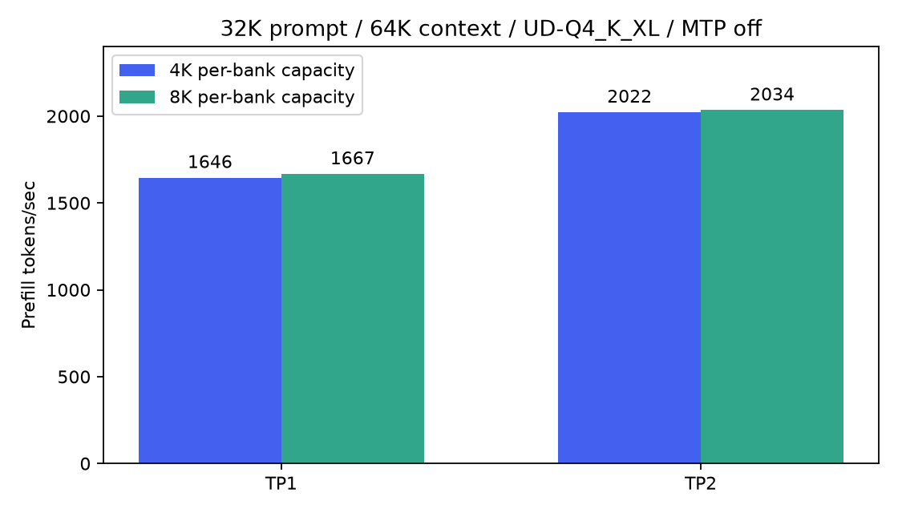

# Larger actual prefill batches: measured result

Matched TP2 ABBA, same UD-Q4_K_XL four shards,32K prompt,65536 context,8 generated
tokens, MTPoff, two40Gb/s USB4 cables/four native rails, native81C6 RXoff/TX32,
fixed Thunderbolt coreBDA. Both variants have96MiB windows and the same bounded
host-write transport patch. This isolates compiled per-bank batch capacity.

| Per-bank capacity | Median of start medians, tok/s |
|---|---:|
|4096|2022.33|
|8192|2034.28|

Observed gain0.59%; two starts per setting, three measured requests/start.
The existing experiment does not establish statistical significance: only two
independent starts per setting were measured. Three requests within a start do
not create three independent treatment assignments. Small effect size alone is
not a reason to reject an optimization. Keep the current default pending stronger
confidence and the transport failure-path qualification below. A follow-up should
use randomized blocked starts, a predeclared analysis and pilot-based sample size,
rather than significance-driven stopping.

Every repeated and cross-setting request has identical prompt/output counts,
prompt hash and completion hash (12 pairwise comparisons). All tracked driver
error/retransmit/timeout/lost deltas were zero during load/inference and teardown,
and across the earlier live transport campaign. Existing nonzero cumulative
copy-error counters predate these tests; counters were not reset.

Candidate reported paired max steps8192,16384,10233 for each start, whereas the
control reported8192 for all requests. This demonstrates the larger geometry was
exercised but checkpoint/scheduler boundaries did not make every step full-sized.
The first controller incorrectly required every request to attain compiled
maximum and stopped after candidate1; that failure/log is preserved. The remaining
starts resumed without rerunning or discarding completed requests. Candidate1's
post-shutdown snapshot was collected later after this assertion; live snapshot
was already captured before teardown. See geometry-validation-correction.json.

Single-node companion ABBA (transport inactive):1645.54→1666.97tok/s (+1.30%),
all measured output hashes match. Uses the same4K/8K batch constants and96MiB
windows, but binaries precede segmentation; this is not an A/B test of transport.

## Transport result and limits

The original8K TP2 exchange exceeded64MiB native max_msg_sz. Registered96MiB
windows do not change that per-WR limit. Splitting the host write into bounded
ordinary writes with final-only IMM/signaled CQ allowed the inference to finish.
This is a compatibility prerequisite, not an independently measured latency win.
Ten live tests through96MiB, both directions, verified full payload/order/reuse;
240 logical messages total. Abrupt-disconnect/partial-post failure qualification
is still outstanding. Do not publish this transport patch as production-ready.

Raw request JSONL lives under results/model-scaling/segmented-chunk-*.jsonl;
serving.csv, summary.json, quality.json and counter-audit.json are in results/.
Profiler use was disabled for this throughput test. No system/driver/boot default,
model precision or disk-backed PLE policy changed.

## Reproduction boundary

This is an experimental investigation result, not a supported tuning flag in
this fork. The generic CLI chunk does not select this geometry. The unmerged
prototype changes Model::kPrefillChunkTokens and uses96MiB host windows in BOTH
variants, plus bounded application WR chains for TP2. Each write respects the
queried native64MiB cap; only the last requests IMM/send CQ. Failure-path
qualification is incomplete. These changes are not required by the one-shot
baseline and are intentionally not bundled into the RX polling PR.

The accompanying CSV/JSON and figure are public summaries. Full source, patches,
commands and raw local logs are retained in the investigation directory; that
private directory is not a downloadable dependency or a public reproduction
package. Do not interpret this record as a released8K transport implementation.
