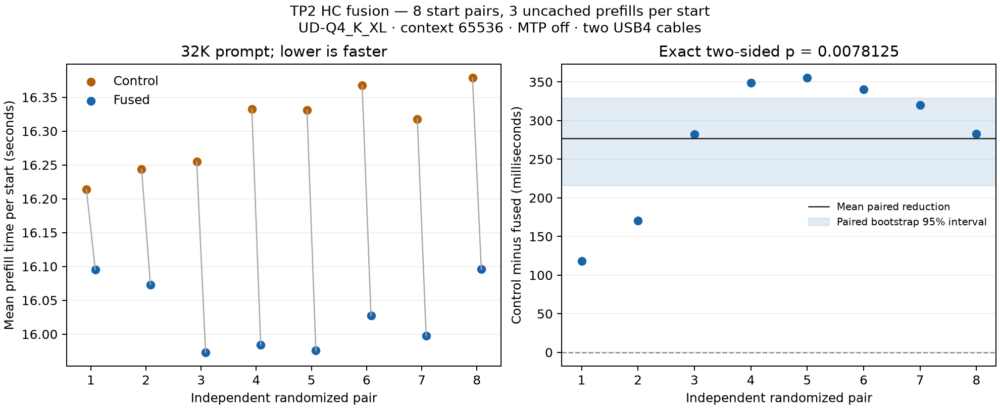

# HC fusion: randomized TP2 prefill confidence test

Recorded 2026-10-28 on EVO-X2/Corsair Strix Halo128GB, two40Gb/s USB4 cables,
four native rails, fixed Thunderbolt coreBDA and native81C6, active pollingoff,
TX32, private ROCm7.14.1. This measures an application-kernel change, not a driver
or link-speed improvement. No system software, storage policy or service changed.

## Result

Eight independently randomized adjacent start pairs,16 starts,48 measured
32768-token prompts plus16 retained warmups. All three prompt latencies within
a start contribute to its arithmetic mean; those requests are clustered rather
than48 independent treatment assignments. Every pair favors the fused candidate.

| Primary measure | Control | Fused |
|---|---:|---:|
| Mean prefill time |16305.026 ms|16027.737 ms|
| Effective prefill rate,32768 tokens / mean time |2009.7 tok/s|2044.5 tok/s|

Mean paired reduction **277.288 ms /1.701% latency**, equivalent to **1.730%
higher prefill rate**. Exact two-sided within-pair randomization p=**0.0078125**
over all256 assignments. Paired percentile bootstrap95% interval for saved time
is **216.149–329.202 ms**, with100000 resamples/seed2026102804. Coverage with
eight clusters is approximate. The protocol/analysis/stopping rule was frozen
before these new outcomes; no slow request was removed or replaced.

This confirms a positive benefit for this workload. Small effect size is not a
reason to reject it. It does **not** establish an ordinary-decode improvement,
all-workload benefit or production-wide qualification.

## Correctness and unresolved gates

All32 matched candidate/control output/work comparisons match; the retained
control-repeat comparisons also match. Additional cache/chunk-work comparisons
have no mismatches. All64 rank/start/load-and-inference/teardown counter windows
have zero increments in the tracked driver error/retry/timeout/lost fields.
Independent operator checks and actual two-rank traces for the same source
preceded this campaign; traces confirmed940 fused calls per32K prompt.

The unchanged5% AND3ms per-request phase qualifier reports **10 passed,0 failed,
6 inconclusive**: four warmup phases and two eight-token decode phases. Timing
ranges overlap or vary; they are not erased by the positive primary test.
Previous C2/cache limitations remain open. **No default promotion.** The baseline
source bundle and standard launch recipe remain unchanged.

## Source and exact profile

[Optional source layer](../patches/gufo-hc-fusion/README.md) applies over the
[measured baseline bundle](../patches/gufo-tp2-baseline/README.md). All four changed
files match the originally measured candidate after canonical formatting.
The source layer passes a fresh release build and five matched TP2 request
comparisons (25 extra work checks and20 bounded timing phases pass; captured
counters clean). These checks are [retained separately](hc-fusion-confidence/packaged-model-parity.json).
It remains experimental: this replay is not statistical timing equivalence or
a clearance of the earlier cold/decode/C2 gates.

- Measured control SHA256: `b288378fe41039f940aed5747c21c0964d9937e0f586e2cef063a2fd087f7599`.
- Measured fused SHA256: `f225fe685afaca27f34c9c78783d1a690438b25e68ab8a8f29ebe935bb52e1d4`.
- Pinned Gufo base: `0b6978aa1709f2ef863f5407e4ca7261191e9046` plus baseline and fusion patches.
- Same four-shard UD-Q4_K_XL, context65536, sessions2, MTP/thinkingoff,
  greedy seed1, CLI chunk2048, actual4K banks,48MiB host windows,
  cache-read bypass and1GiB snapshot budget. No full-table warming.
- Each start: one8-output warmup, then three uncached exact32768-token prompts,
  each with8 generated outputs. The candidate preserves rounded FP32 peer addition
  before HC combine and existing fallback/stream lifetime conditions.



## Recompute and inspect

[Raw start/request times](hc-fusion-confidence/starts.csv),
[frozen analysis plan](hc-fusion-confidence/analysis-plan.json),
[primary result](hc-fusion-confidence/primary.json) and
[all phase/counter qualification details](hc-fusion-confidence/qualification.json).
Recompute the exact primary result using only Python's standard library:

```bash
python3 docs/experiments/hc-fusion-confidence/analyze-primary.py
```

The script checks all16 starts and reproduces the recorded JSON exactly. Per-pair
random assignment uses seed2026102803; the lab's full controller, request JSONL,
source/dependency hashes, inventories and snapshots remain under
`~/strix-dispatch-investigation/hc-fusion-confidence/`. These summary data are not
a fresh-OS installer or an independent end-to-end model-quality oracle.
